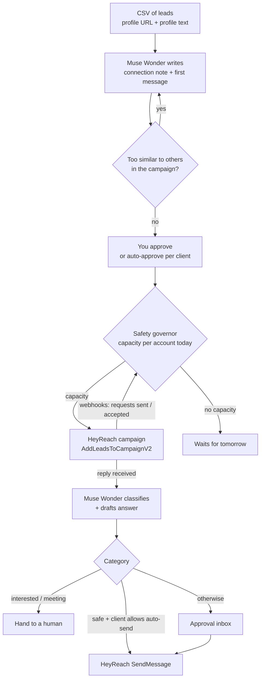

# ReachGuard

**An open-source LinkedIn outreach agent for agencies: HeyReach sends, and Muse Wonder writes like a person, protects every account, and answers replies around the clock.**

ReachGuard runs on your computer with your own keys. You import leads. Meta's **Muse Wonder** writes a different connection note and first message for each person, and checks that no two in a campaign sound alike. A **safety governor** then decides how many leads each LinkedIn account may take today, and approved leads are added to your [HeyReach](https://heyreach.io) campaigns. When people reply, Muse Wonder classifies the reply and drafts an answer for you to approve. Once a week it writes a report for each client.

Nothing is added to HeyReach, and no LinkedIn message is sent, until you turn on **live mode**.

---

## Contents
1. [Why it exists](#why-it-exists)
2. [How it works](#how-it-works)
3. [Features](#features)
4. [Quick start](#quick-start)
5. [Connecting HeyReach and Muse Wonder](#connecting-heyreach-and-muse-wonder)
6. [Daily workflow](#daily-workflow)
7. [The safety governor](#the-safety-governor)
8. [The reply agent](#the-reply-agent)
9. [Lead and conversation lifecycle](#lead-and-conversation-lifecycle)
10. [Costs](#costs)
11. [Troubleshooting](#troubleshooting)
12. [Configuration reference](#configuration-reference)
13. [Project structure and development](#project-structure-and-development)

---

## Why it exists

Agencies running LinkedIn outreach for clients carry risks that most automation ignores. These are the problems ReachGuard was built to solve:

### 1. LinkedIn accounts get restricted
A restricted account doesn't just stop sending. It stops a client's pipeline, often needs ID verification to recover, and is the fastest way to lose the client. Most automation pushes as much volume as it can and only reacts after LinkedIn does.

**What ReachGuard does:** a **safety governor** sits between you and HeyReach. Every account gets a daily and weekly limit, new accounts start slowly and build up over two weeks, and acceptance rates from HeyReach's webhooks are watched continuously. When acceptance drops, volume halves. When it drops further, the campaigns that account was feeding are paused automatically. If LinkedIn shows a warning, one button stops that account immediately.

> This lowers the risk of restrictions; it cannot remove it. Automating LinkedIn is against LinkedIn's terms of service.

### 2. Every message sounds the same
Templates with a first name swapped in are easy to spot, both for prospects and for LinkedIn's spam detection. Repetitive wording across many sends is one of the clearest patterns that gets accounts flagged.

**What ReachGuard does:** Muse Wonder writes each connection note and first message from **that person's own profile text**, with templated openers banned. Every message is then compared with the rest of the campaign, and anything too similar is rewritten before you see it.

### 3. Replies wait, and hot leads go cold
A "yes, let's talk" that lands on Friday evening often sits until Monday. By then the moment has passed. Agencies that don't own reply handling quietly lose deals they already won.

**What ReachGuard does:** every reply is **classified and a draft answer is ready within seconds**, written from the whole conversation. Interested leads and meeting requests are always handed to a human, never auto-answered. Low-risk replies ("not now", "talk to my colleague") can be answered automatically, but only for clients who allow it.

### 4. Follow-ups that add nothing
"Just bumping this up" teaches prospects to ignore you.

**What ReachGuard does:** reply drafts use the full conversation history, so each message responds to what the person actually said.

### 5. Client reporting eats Friday afternoons
Agencies spend hours every week pulling numbers out of tools and turning them into something a client will read.

**What ReachGuard does:** one click writes each client's **weekly report** from the real numbers: leads added, connection requests and acceptances, replies by type, conversations worth a look, and every safety action taken. Download it as Markdown and send it.

### 6. Managing many clients in one tool
Mixing clients' accounts, campaigns and rules is how mistakes happen.

**What ReachGuard does:** each client has its own LinkedIn accounts, campaigns, approval rules and auto-reply rules. Nothing is added to HeyReach and no message is sent until you turn on live mode.

### At a glance

| Pain point for LinkedIn agencies | What ReachGuard does about it |
|---|---|
| **Accounts get restricted** | A daily and weekly limit per account, a slow start for new accounts, half volume when acceptance drops, and campaigns paused automatically when it drops further. A "report LinkedIn warning" button stops an account instantly. |
| **Messages sound robotic** | Copy is written from each person's profile text, with templated openers banned. |
| **Repeated wording gets flagged** | Every note and message is compared with the rest of the campaign. Anything too similar is rewritten. |
| **Replies sit unanswered over the weekend** | Webhooks trigger reply drafting within seconds. A polling fallback runs every 10 minutes. |
| **Hollow follow-ups** | Replies are drafted from the whole conversation history. |
| **Interested leads mishandled by automation** | Interested leads and meeting requests are always handed to a human, never auto-answered. |
| **Client reporting takes hours** | One-click weekly report per client, written from real numbers, downloadable as Markdown. |

---

## How it works



---

## Features

- **Setup page** (`/setup`): paste your Muse Wonder and HeyReach keys, test them, sync accounts and campaigns, generate a webhook token (with the exact URL to paste into HeyReach), and turn live mode on.
- **Getting-started checklist** on the dashboard.
- **Clients:** each agency client gets its own LinkedIn accounts, HeyReach campaigns and notes about its offer, approval rules and auto-reply rules.
- **Lead import** from CSV, with a downloadable template. Duplicates are skipped per campaign, and only valid LinkedIn profile URLs are accepted.
- **Outreach writer:** a connection note (up to 200 characters) and a first message (up to 600 characters), each with the profile detail it was based on, plus the similarity check and rewrite.
- **Review:** edit any note or message, approve one at a time or approve every draft in a campaign without warnings at once.
- **Safety governor:** limits, slow start for new accounts, acceptance-rate thresholds, campaign auto-pause and manual restriction reports.
- **Push** to HeyReach spread across the client's accounts, always to the account with the most capacity left today.
- **Reply agent:** classifies replies into 9 categories, drafts answers from the full conversation, hands interested leads to a human, and auto-replies only in categories each client allows.
- **Inbox** with tabs: awaiting approval / handed off / sent / failed / closed.
- **Weekly client report** written by Muse Wonder from ReachGuard's numbers and HeyReach stats, downloadable as `.md`.
- **Events log** of every webhook delivery, governor action and integration error.
- **Safety:** live mode is off by default and needs a typed confirmation, there's an optional UI password, and webhooks are protected by a token.

---

## Quick start

**You need:** Node.js **22.13 or newer** (it uses the built-in `node:sqlite`), git, a HeyReach account with API access, and a Meta Model API key.

```bash
git clone https://github.com/thoughtpilot99/muse-x-heyreach.git
cd muse-x-heyreach
npm install
npm run dev
```

Open **http://localhost:3000** and follow the *Getting started* checklist:

1. **Setup → Muse Wonder:** paste your key, then **Test**.
2. **Setup → HeyReach:** paste your key, **Test**, then **Sync accounts and campaigns**.
3. **Clients:** create a client and describe its offer (what it sells, to whom, proof points, words to avoid).
4. **Client page:** assign its LinkedIn accounts and HeyReach campaigns, and choose the approval and auto-reply rules.
5. **Leads:** download the CSV template, fill it in (the `about` column is what Muse Wonder writes from), and import it.
6. Review the drafted notes and messages. Edit and approve them.
7. **Setup → Webhooks:** generate the token and register the URL in HeyReach (see below).
8. **Setup → Go live:** type `LIVE`. Approved leads are then added to HeyReach within each account's limit, and approved replies are sent.

To run it for real use rather than development, run `npm run build && npm start`.

---

## Connecting HeyReach and Muse Wonder

### Muse Wonder
Create a key at **[dev.meta.ai](https://dev.meta.ai) → API keys**. Default model: `muse-wonder-1.0` (preview), through `https://api.meta.ai/v1`.

### HeyReach
1. **API key:** HeyReach → Settings → Integrations → API. Paste it on **Setup**.
2. **Campaign template:** in each campaign ReachGuard feeds, use the lead custom fields as the step text:
   - Connection request note: `{rg_connection_note}`
   - Message after acceptance: `{rg_first_message}`
3. **Start the campaign** in HeyReach. It only accepts new leads into active campaigns.
4. **Match the limits:** keep HeyReach's own per-account limits at or below ReachGuard's limits (Settings). ReachGuard controls how many leads are *added* per day; HeyReach then sends on its own schedule.
5. **Webhooks (recommended):** they give ReachGuard acceptance rates for the safety governor, and reply drafting within seconds.
   - Set `APP_PASSWORD` in `.env.local`, then expose the app: `cloudflared tunnel --url http://localhost:3000`
   - On **Setup → Webhooks**, click **Generate webhook token** and copy the URL it shows:
     `https://<tunnel>/api/webhooks/heyreach?token=<token>`
   - In HeyReach → Settings → Integrations → Webhooks, create webhooks for **Connection request sent**, **Connection request accepted** and **Message reply received** pointing to that URL.

   Without webhooks, replies are still picked up by polling every 10 minutes, but the acceptance-rate checks have no data to work from.

---

## Daily workflow

1. **Inbox first.** Answer the replies waiting for approval. Hot leads (interested, meeting requests) are flagged *hand to a human*.
2. **Account safety.** Glance at the health grid: green, amber (slowed down) or red (paused). If LinkedIn showed a warning on any account, click **Report LinkedIn warning**.
3. **Leads.** Approve new drafts. The governor pushes them every 10 minutes within each account's capacity.
4. **Fridays.** On each client's page, click **Write this week's report** and download it from **Reports**.

Every automatic job has a **Run now** button. Set `RG_JOBS_ENABLED=0` to make everything manual.

---

## The safety governor

Each LinkedIn account gets a limit for today, worked out like this:

| Rule | Default (Settings) |
|---|---|
| Daily limit per account | 25 (maximum 40 allowed) |
| Weekly limit per account | 100 (maximum 150 allowed) |
| Slow start for new accounts | Starts at 8/day and reaches the daily limit over 14 days |
| Acceptance below the "slow down" threshold | 20% → daily limit halved |
| Acceptance below the "pause" threshold | 10% → account paused, and its HeyReach campaigns from the last 14 days paused |
| Minimum data before acceptance counts | 25 connection requests in 7 days |
| Manual warning report | Account paused immediately and its campaigns paused |

A paused account stays paused until you clear it. Clearing it restarts the slow start. Campaigns paused by the governor are listed on **Account safety**, where you can resume them (live mode required).

---

## The reply agent

| Category | What happens |
|---|---|
| `interested`, `meeting_request` | Draft proposes times. **Always handed to a human**, never auto-sent. |
| `question`, `objection` | Draft answers what they asked. Auto-sent only if the client allows it. |
| `not_now`, `referral`, `not_interested`, `unsubscribe`, `other` | Polite, short drafts. Auto-sent only if the client allows it. |

Auto-sending also requires live mode. Every sent message is added to the conversation history, so the next draft stays consistent.

---

## Lead and conversation lifecycle

| Lead status | Meaning | What moves it |
|---|---|---|
| `new` | Imported | The drafting job (every minute) or **Draft new leads** |
| `drafted` | Copy written and waiting for review (or flagged as too similar) | **Save and approve** / **Approve all** |
| `approved` | Ready to push | The governor and push job (every 10 minutes, live mode on) |
| `pushed` | Added to the HeyReach campaign under a specific account | HeyReach sends the steps |
| `failed` | An API error | **Rewrite with Muse Wonder** |

| Conversation status | Meaning |
|---|---|
| `awaiting_approval` | A draft reply is ready for you |
| `handed_off` | A hot lead you replied to; a human now owns it |
| `sent` | The reply was sent through HeyReach |
| `failed` / `closed` | An error / closed without replying |

---

## Costs

| Item | Cost |
|---|---|
| ReachGuard | Free (MIT) |
| Muse Wonder | $4 per million input tokens, $20 per million output tokens ($0.20 per million for cached input). Roughly a few cents per drafted lead or reply. Similarity rewrites and long conversations cost more. The dashboard shows your running spend. |
| HeyReach | Your HeyReach plan (billed per LinkedIn account). |

---

## Troubleshooting

| Symptom | Fix |
|---|---|
| "Not connected yet" banner | Connect Muse Wonder and HeyReach on **Setup**. |
| Push says it's waiting for live mode | Turn live mode on in **Setup** (type `LIVE`). |
| "waiting for account capacity" | The accounts used today's limit, are slowed down, or are paused. See **Account safety**. |
| HeyReach rejects new leads | The campaign is a draft. Start it in HeyReach. |
| Acceptance shows "no data yet" | Webhooks aren't registered, or not for the *connection request* events. |
| A webhook returns 503 / 401 | No token generated yet / the token in the URL is wrong. Regenerate it on Setup and update HeyReach. |
| A drafted lead has a warning | Its wording is close to another message in the campaign. Edit it, or **Rewrite with Muse Wonder**. |
| A reply wasn't picked up | Check **Events**. HeyReach's webhook format isn't formally documented, so if a field is missed, adjust `readWebhook` in `lib/inbox.ts`. |

---

## Configuration reference

Set things on the **Setup** and **Settings** pages, or in `.env.local` (which overrides the app). See [.env.example](.env.example).

| Variable | Purpose |
|---|---|
| `MODEL_API_KEY` | Muse Wonder (Meta Model API) key |
| `HEYREACH_API_KEY` | HeyReach API key |
| `HEYREACH_WEBHOOK_TOKEN` | Secret token in the webhook URL |
| `RG_LIVE_ENABLED` | Empty = controlled from Setup · `0` = force off · `1` = force on |
| `APP_PASSWORD` | Password for the whole UI (set it before using a tunnel) |
| `RG_JOBS_ENABLED` | `0` turns off background jobs |
| `MUSE_MODEL`, `MUSE_BASE_URL` | Model and endpoint overrides |

**Settings page:** agency name, tone, maximum similarity between messages, and all the governor thresholds.

---

## Project structure and development

```
app/
  setup/              Connect page + server actions
  clients/            Clients, assignment, report trigger
  leads/              Import, review, sample CSV
  inbox/ accounts/ reports/ events/ settings/
  api/webhooks/heyreach  Webhook receiver (token protected)
lib/
  heyreach.ts   HeyReach client (endpoints from HeyReach's Postman collection), rate limiter, tolerant readers
  governor.ts   Limits, slow start, acceptance thresholds, pausing (decide() is the pure rule)
  outreach.ts   Sync, import, drafting with similarity checks, pushing
  inbox.ts      Webhook reader, reply agent, polling fallback, sending
  agents.ts     Muse Wonder prompts: outreach copy, reply triage, client report
  reports.ts    Weekly numbers + report
  config.ts / secrets.ts   Settings from .env.local or the Setup page; live switch
data/app.db     Local SQLite database (gitignored)
```

```bash
npm test          # vitest: HeyReach client, governor, push distribution, reply agent, CSV, live-mode gates
npx tsc --noEmit
npm run lint
npm run build
```

CI (`.github/workflows/ci.yml`) runs lint, type check, tests and build on every push.

## License
MIT. See [LICENSE](LICENSE).
